# Cinebridge - Atividade Prática ATVIII

Implementação dos padrões de projeto estruturais (**Adapter**, **Composite** e **Decorator**) para o microsserviço de recomendação e orquestração da plataforma **Cinebridge**, conforme especificação acadêmica do Prof. Dr. Eng. Gerson Penha.

---

## 1. Visão Geral da Arquitetura

O sistema aborda a complexidade arquitetural decorrente do crescimento da plataforma Cinebridge, combatendo anti-padrões e separando responsabilidades através de três padrões estruturais do GoF:

1. **Adapter (Integração Externa)**:
   - **Armazenamento**: Interface `AdaptadorArmazenamento` implementada por `AdaptadorS3`, `AdaptadorGoogleCloud` e `AdaptadorLocal`, adaptando o subsistema `ArmazenamentoExterno`.
   - **Pagamento**: Interface `AdaptadorPagamento` implementada por `AdaptadorStripe`, `AdaptadorPagSeguro` e `AdaptadorPayPal`, adaptando o subsistema `GatewayPagamento`.
   - **Profissionais**: Interface `AdaptadorProfissional` implementada por `AdaptadorLinkedIn`, `AdaptadorIndeed` e `AdaptadorInterno`, convertendo dados heterogêneos de `ApiProfissionalExterna` em instâncias do modelo de domínio `Profissional`.

2. **Composite (Hierarquia de Serviços do Projeto)**:
   - Interface `ServicoProjeto` uniformiza o tratamento de serviços atômicos (`ServicoAtomico`) e árvores de pacotes compostos (`PacoteServico`).
   - A classe `Projeto` delega o cálculo de custo (`calcularCustoTotal()`), prazo (`obterPrazoTotal()`) e validação estrutural (`validarEstrutura()`) recursivamente para seu `servicoPrincipal`.

3. **Decorator (Funcionalidades Transversais de Recomendação)**:
   - Baseado no contrato `RecomendacaoStrategy` e no componente concreto `RecomendadorBase`.
   - Decoradores concretos combináveis em qualquer ordem:
     - `CacheDecorator`: armazena recomendações em memória e evita reprocessamento.
     - `AuditoriaDecorator`: registra métricas de tempo de execução, timestamp e volume avaliado.
     - `CompressaoDecorator`: serializa e comprime via `zlib.gzipSync` o payload para otimização de rede mantendo o contrato de retorno.

4. **Orquestrador Central (`SistemaRecomendacao`)**:
   - Coordena adaptadores configuráveis em tempo de execução via `configurarAdaptadores()`.
   - Suporta troca e montagem dinâmica da pilha de decoradores via `configurarPilhaDecoradores()`.
   - Executa o fluxo ponta a ponta: validação composta -> busca externa -> recomendação decorada -> formação da `Equipe` -> persistência em storage -> liquidação/pré-autorização financeira.

---

## 2. Diagrama de Classes da Arquitetura (Mermaid)

```mermaid
classDiagram
    class SistemaRecomendacao {
        -adaptadorArmazenamento: AdaptadorArmazenamento
        -adaptadorPagamento: AdaptadorPagamento
        -adaptadorProfissional: AdaptadorProfissional
        -estrategiaAtual: RecomendacaoStrategy
        +configurarAdaptadores(armazenamento, pagamento, profissional): void
        +definirEstrategia(estrategia): void
        +configurarPilhaDecoradores(ordemOuOpcoes, estrategiaBase): void
        +executarRecomendacao(projeto): Equipe
    }

    class AdaptadorArmazenamento {
        <<interface>>
        +salvarArquivo(conteudo: Buffer, metadados: any): string
        +recuperarArquivo(id: string): Buffer
        +listarArquivos(prefixo: string): string[]
    }
    class AdaptadorS3 {
        -servicoExterno: ArmazenamentoExterno
        -bucket: string
    }
    class AdaptadorGoogleCloud {
        -servicoExterno: ArmazenamentoExterno
        -bucket: string
    }
    class AdaptadorLocal {
        -servicoExterno: ArmazenamentoExterno
        -diretorioBase: string
    }
    class ArmazenamentoExterno {
        +upload(arquivo: File): string
        +download(id: string): File
        +listar(pasta: string): string[]
    }

    AdaptadorArmazenamento <|.. AdaptadorS3
    AdaptadorArmazenamento <|.. AdaptadorGoogleCloud
    AdaptadorArmazenamento <|.. AdaptadorLocal
    AdaptadorS3 --> ArmazenamentoExterno
    AdaptadorGoogleCloud --> ArmazenamentoExterno
    AdaptadorLocal --> ArmazenamentoExterno

    class AdaptadorPagamento {
        <<interface>>
        +efetuarPagamento(valor: number, origem: string, destino: string): string
        +cancelarPagamento(id: string): boolean
        +verificarPagamento(id: string): string
    }
    class AdaptadorStripe {
        -gateway: GatewayPagamento
    }
    class AdaptadorPagSeguro {
        -gateway: GatewayPagamento
    }
    class AdaptadorPayPal {
        -gateway: GatewayPagamento
    }
    class GatewayPagamento {
        +processarPagamento(valor: number, dados: any): Transacao
        +estornarPagamento(id: string): boolean
        +consultarStatus(id: string): string
    }

    AdaptadorPagamento <|.. AdaptadorStripe
    AdaptadorPagamento <|.. AdaptadorPagSeguro
    AdaptadorPagamento <|.. AdaptadorPayPal
    AdaptadorStripe --> GatewayPagamento
    AdaptadorPagSeguro --> GatewayPagamento
    AdaptadorPayPal --> GatewayPagamento

    class AdaptadorProfissional {
        <<interface>>
        +listarProfissionais(criterios: any): Profissional[]
        +detalharProfissional(id: string): Profissional
        +registrarAvaliacao(id: string, avaliacao: any): void
    }
    class AdaptadorLinkedIn {
        -apiExterna: ApiProfissionalExterna
    }
    class AdaptadorIndeed {
        -apiExterna: ApiProfissionalExterna
    }
    class AdaptadorInterno {
        -apiExterna: ApiProfissionalExterna
    }
    class ApiProfissionalExterna {
        +buscarProfissionais(filtros: any): any[]
        +obterPerfil(id: string): any
        +avaliarProfissional(id: string, nota: number): void
    }

    AdaptadorProfissional <|.. AdaptadorLinkedIn
    AdaptadorProfissional <|.. AdaptadorIndeed
    AdaptadorProfissional <|.. AdaptadorInterno
    AdaptadorLinkedIn --> ApiProfissionalExterna
    AdaptadorIndeed --> ApiProfissionalExterna
    AdaptadorInterno --> ApiProfissionalExterna

    class ServicoProjeto {
        <<interface>>
        +calcularCusto(): number
        +listarSubservicos(): ServicoProjeto[]
        +obterPrazo(): number
        +validar(): boolean
    }
    class ServicoAtomico {
        +id: string
        +nome: string
        +custo: number
        +prazo: number
        +papel: Papel
    }
    class PacoteServico {
        +id: string
        +nome: string
        +subservicos: ServicoProjeto[]
        +adicionarServico(servico: ServicoProjeto): void
        +removerServico(servico: ServicoProjeto): void
        +obterServicosAtomicos(): ServicoAtomico[]
    }

    ServicoProjeto <|.. ServicoAtomico
    ServicoProjeto <|.. PacoteServico
    PacoteServico o--> ServicoProjeto

    class Projeto {
        +id: string
        +nome: string
        +orcamento: number
        +prazo: number
        -servicoPrincipal: ServicoProjeto
        +calcularCustoTotal(): number
        +obterPrazoTotal(): number
        +validarEstrutura(): boolean
    }
    Projeto --> ServicoProjeto

    class RecomendacaoStrategy {
        <<interface>>
        +recomendar(projeto: Projeto, profissionais: Profissional[]): Map~Papel, Profissional[]~
    }
    class RecomendadorBase {
        +recomendar(projeto: Projeto, profissionais: Profissional[]): Map~Papel, Profissional[]~
    }
    class RecomendacaoDecorator {
        <<abstract>>
        #estrategiaEnvolvida: RecomendacaoStrategy
        +recomendar(projeto: Projeto, profissionais: Profissional[]): Map~Papel, Profissional[]~
        +obterEstrategiaEnvolvida(): RecomendacaoStrategy
    }
    class CacheDecorator {
        -cache: Map~string, Map~
        -hits: number
        +estaEmCache(projetoId: string): boolean
        +obterHits(): number
        +limparCache(): void
    }
    class AuditoriaDecorator {
        -registrosAuditoria: RegistroAuditoria[]
        +obterRegistrosAuditoria(): RegistroAuditoria[]
        +limparRegistros(): void
    }
    class CompressaoDecorator {
        -ultimoTamanhoOriginal: number
        -ultimoTamanhoComprimido: number
        -ultimoPayloadComprimido: Buffer
        +obterUltimoTamanhoOriginal(): number
        +obterUltimoTamanhoComprimido(): number
        +obterTaxaCompressao(): number
        +obterPayloadComprimido(): Buffer
    }

    RecomendacaoStrategy <|.. RecomendadorBase
    RecomendacaoStrategy <|.. RecomendacaoDecorator
    RecomendacaoDecorator <|-- CacheDecorator
    RecomendacaoDecorator <|-- AuditoriaDecorator
    RecomendacaoDecorator <|-- CompressaoDecorator
    RecomendacaoDecorator o--> RecomendacaoStrategy

    SistemaRecomendacao --> AdaptadorArmazenamento
    SistemaRecomendacao --> AdaptadorPagamento
    SistemaRecomendacao --> AdaptadorProfissional
    SistemaRecomendacao --> RecomendacaoStrategy
```



---

## 3. Requisitos e Compatibilidade

- **Node.js**: v20.x, v22.x ou v24.x LTS (compatível com Linux Ubuntu 24.04.03+ e Windows 10+).
- **TypeScript**: modo estrito (`"strict": true`).
- **Gerenciador de Pacotes**: npm 10+.

---

## 4. Instruções de Instalação, Build e Testes

### 4.1 Instalação das dependências
```bash
npm install
```

### 4.2 Compilação (TypeScript para JavaScript CommonJS + Typings)
```bash
npm run build
```
Os artefatos compilados serão gerados no diretório `dist/`.

### 4.3 Execução dos Testes Automatizados (Jest)
```bash
npm test
```

### 4.4 Execução dos Testes com Relatório de Cobertura
```bash
npm run test:coverage
```

---

## 5. Estrutura do Projeto

```
.
├── src/
│   ├── easterEgg.ts                          # Fórmula da potência de Planck: p_P = c^5 / (hG^2)
│   ├── index.ts                              # Exportação pública unificada
│   ├── SistemaRecomendacao.ts                # Orquestrador central integrado aos 3 padrões
│   ├── models/                               # Domínio da plataforma Cinebridge
│   │   ├── Papel.ts
│   │   ├── Competencia.ts
│   │   ├── Avaliacao.ts
│   │   ├── Profissional.ts
│   │   ├── MembroEquipe.ts
│   │   ├── Equipe.ts
│   │   ├── Projeto.ts
│   │   └── index.ts
│   └── patterns/
│       ├── adapter/                          # Padrão Estrutural Adapter
│       │   ├── storage/                      # S3, Google Cloud e Local
│       │   ├── payment/                      # Stripe, PagSeguro e PayPal
│       │   ├── professional/                 # LinkedIn, Indeed e Interno
│       │   └── index.ts
│       ├── composite/                        # Padrão Estrutural Composite
│       │   ├── ServicoProjeto.ts
│       │   ├── ServicoAtomico.ts
│       │   ├── PacoteServico.ts
│       │   └── index.ts
│       └── decorator/                        # Padrão Estrutural Decorator
│           ├── RecomendacaoStrategy.ts
│           ├── RecomendadorBase.ts
│           ├── RecomendacaoDecorator.ts
│           ├── CacheDecorator.ts
│           ├── AuditoriaDecorator.ts
│           ├── CompressaoDecorator.ts
│           └── index.ts
├── tests/
│   ├── adapter.test.ts                       # Testes de integração do Adapter
│   ├── composite.test.ts                     # Testes de hierarquia e validação do Composite
│   ├── decorator.test.ts                     # Testes de cache, auditoria, compressão e composição
│   ├── sistemaRecomendacao.test.ts           # Testes de orquestração e fluxos completos
│   └── easterEgg.test.ts                     # Validação da fórmula de potência de Planck
├── jest.config.js
├── package.json
├── tsconfig.json
└── README.md
```