# tec 2 - Atividade Prática ATVIII


---

## 1. Visão Geral


1. **Adapter**:
   - **Armazenamento**: Interface `AdaptadorArmazenamento` implementada por `AdaptadorS3`, `AdaptadorGoogleCloud` e `AdaptadorLocal`, adaptando o subsistema `ArmazenamentoExterno`.
   - **Pagamento**: Interface `AdaptadorPagamento` implementada por `AdaptadorStripe`, `AdaptadorPagSeguro` e `AdaptadorPayPal`, adaptando o subsistema `GatewayPagamento`.
   - **Profissionais**: Interface `AdaptadorProfissional` implementada por `AdaptadorLinkedIn`, `AdaptadorIndeed` e `AdaptadorInterno`, convertendo dados heterogêneos de `ApiProfissionalExterna` em instâncias do modelo de domínio `Profissional`.

2. **Composite**:
   - Interface `ServicoProjeto` uniformiza o tratamento de serviços atômicos (`ServicoAtomico`) e árvores de pacotes compostos (`PacoteServico`).
   - A classe `Projeto` delega o cálculo de custo (`calcularCustoTotal()`), prazo (`obterPrazoTotal()`) e validação estrutural (`validarEstrutura()`) recursivamente para seu `servicoPrincipal`.

3. **Decorator**:
   - Baseado no contrato `RecomendacaoStrategy` e no componente concreto `RecomendadorBase`.
   - Decoradores concretos combináveis em qualquer ordem:
     - `CacheDecorator`: armazena recomendações em memória e evita reprocessamento.
     - `AuditoriaDecorator`: registra métricas de tempo de execução, timestamp e volume avaliado.
     - `CompressaoDecorator`: serializa e comprime via `zlib.gzipSync` o payload para otimização de rede mantendo o contrato de retorno.

4. **`SistemaRecomendacao`**:
   - Coordena adaptadores configuráveis em tempo de execução via `configurarAdaptadores()`.
   - Suporta troca e montagem dinâmica da pilha de decoradores via `configurarPilhaDecoradores()`.
   - Executa o fluxo ponta a ponta: validação composta -> busca externa -> recomendação decorada -> formação da `Equipe` -> persistência em storage -> liquidação/pré-autorização financeira.

---

## 2. Diagrama de Classes da Arquitetura em mermaid

```mermaid
classDiagram
    class SistemaRecomendacao {
        -adaptadorArmazenamento: AdaptadorArmazenamento
        -adaptadorPagamento: AdaptadorPagamento
        -adaptadorProfissional: AdaptadorProfissional
        -estrategiaAtual: RecomendacaoStrategy
        +configurarAdaptadores(armazenamento, pagamento, profissional): void
        +definirEstrategia(estrategia): void
        +configurarPilhaDecoradores(ordemOuOpcoes, estrategiaBase): void
        +executarRecomendacao(projeto): Equipe
    }

    class AdaptadorArmazenamento {
        <<interface>>
        +salvarArquivo(conteudo: Buffer, metadados: any): string
        +recuperarArquivo(id: string): Buffer
        +listarArquivos(prefixo: string): string[]
    }
    class AdaptadorS3 {
        -servicoExterno: ArmazenamentoExterno
        -bucket: string
    }
    class AdaptadorGoogleCloud {
        -servicoExterno: ArmazenamentoExterno
        -bucket: string
    }
    class AdaptadorLocal {
        -servicoExterno: ArmazenamentoExterno
        -diretorioBase: string
    }
    class ArmazenamentoExterno {
        +upload(arquivo: File): string
        +download(id: string): File
        +listar(pasta: string): string[]
    }

    AdaptadorArmazenamento <|.. AdaptadorS3
    AdaptadorArmazenamento <|.. AdaptadorGoogleCloud
    AdaptadorArmazenamento <|.. AdaptadorLocal
    AdaptadorS3 --> ArmazenamentoExterno
    AdaptadorGoogleCloud --> ArmazenamentoExterno
    AdaptadorLocal --> ArmazenamentoExterno

    class AdaptadorPagamento {
        <<interface>>
        +efetuarPagamento(valor: number, origem: string, destino: string): string
        +cancelarPagamento(id: string): boolean
        +verificarPagamento(id: string): string
    }
    class AdaptadorStripe {
        -gateway: GatewayPagamento
    }
    class AdaptadorPagSeguro {
        -gateway: GatewayPagamento
    }
    class AdaptadorPayPal {
        -gateway: GatewayPagamento
    }
    class GatewayPagamento {
        +processarPagamento(valor: number, dados: any): Transacao
        +estornarPagamento(id: string): boolean
        +consultarStatus(id: string): string
    }

    AdaptadorPagamento <|.. AdaptadorStripe
    AdaptadorPagamento <|.. AdaptadorPagSeguro
    AdaptadorPagamento <|.. AdaptadorPayPal
    AdaptadorStripe --> GatewayPagamento
    AdaptadorPagSeguro --> GatewayPagamento
    AdaptadorPayPal --> GatewayPagamento

    class AdaptadorProfissional {
        <<interface>>
        +listarProfissionais(criterios: any): Profissional[]
        +detalharProfissional(id: string): Profissional
        +registrarAvaliacao(id: string, avaliacao: any): void
    }
    class AdaptadorLinkedIn {
        -apiExterna: ApiProfissionalExterna
    }
    class AdaptadorIndeed {
        -apiExterna: ApiProfissionalExterna
    }
    class AdaptadorInterno {
        -apiExterna: ApiProfissionalExterna
    }
    class ApiProfissionalExterna {
        +buscarProfissionais(filtros: any): any[]
        +obterPerfil(id: string): any
        +avaliarProfissional(id: string, nota: number): void
    }

    AdaptadorProfissional <|.. AdaptadorLinkedIn
    AdaptadorProfissional <|.. AdaptadorIndeed
    AdaptadorProfissional <|.. AdaptadorInterno
    AdaptadorLinkedIn --> ApiProfissionalExterna
    AdaptadorIndeed --> ApiProfissionalExterna
    AdaptadorInterno --> ApiProfissionalExterna

    class ServicoProjeto {
        <<interface>>
        +calcularCusto(): number
        +listarSubservicos(): ServicoProjeto[]
        +obterPrazo(): number
        +validar(): boolean
    }
    class ServicoAtomico {
        +id: string
        +nome: string
        +custo: number
        +prazo: number
        +papel: Papel
    }
    class PacoteServico {
        +id: string
        +nome: string
        +subservicos: ServicoProjeto[]
        +adicionarServico(servico: ServicoProjeto): void
        +removerServico(servico: ServicoProjeto): void
        +obterServicosAtomicos(): ServicoAtomico[]
    }

    ServicoProjeto <|.. ServicoAtomico
    ServicoProjeto <|.. PacoteServico
    PacoteServico o--> ServicoProjeto

    class Projeto {
        +id: string
        +nome: string
        +orcamento: number
        +prazo: number
        -servicoPrincipal: ServicoProjeto
        +calcularCustoTotal(): number
        +obterPrazoTotal(): number
        +validarEstrutura(): boolean
    }
    Projeto --> ServicoProjeto

    class RecomendacaoStrategy {
        <<interface>>
        +recomendar(projeto: Projeto, profissionais: Profissional[]): Map~Papel, Profissional[]~
    }
    class RecomendadorBase {
        +recomendar(projeto: Projeto, profissionais: Profissional[]): Map~Papel, Profissional[]~
    }
    class RecomendacaoDecorator {
        <<abstract>>
        #estrategiaEnvolvida: RecomendacaoStrategy
        +recomendar(projeto: Projeto, profissionais: Profissional[]): Map~Papel, Profissional[]~
        +obterEstrategiaEnvolvida(): RecomendacaoStrategy
    }
    class CacheDecorator {
        -cache: Map~string, Map~
        -hits: number
        +estaEmCache(projetoId: string): boolean
        +obterHits(): number
        +limparCache(): void
    }
    class AuditoriaDecorator {
        -registrosAuditoria: RegistroAuditoria[]
        +obterRegistrosAuditoria(): RegistroAuditoria[]
        +limparRegistros(): void
    }
    class CompressaoDecorator {
        -ultimoTamanhoOriginal: number
        -ultimoTamanhoComprimido: number
        -ultimoPayloadComprimido: Buffer
        +obterUltimoTamanhoOriginal(): number
        +obterUltimoTamanhoComprimido(): number
        +obterTaxaCompressao(): number
        +obterPayloadComprimido(): Buffer
    }

    RecomendacaoStrategy <|.. RecomendadorBase
    RecomendacaoStrategy <|.. RecomendacaoDecorator
    RecomendacaoDecorator <|-- CacheDecorator
    RecomendacaoDecorator <|-- AuditoriaDecorator
    RecomendacaoDecorator <|-- CompressaoDecorator
    RecomendacaoDecorator o--> RecomendacaoStrategy

    SistemaRecomendacao --> AdaptadorArmazenamento
    SistemaRecomendacao --> AdaptadorPagamento
    SistemaRecomendacao --> AdaptadorProfissional
    SistemaRecomendacao --> RecomendacaoStrategy
```




---

## 3. Instruções de Instalação, Build e Testes

### 3.1 Instalação das dependências
```bash
npm install
```

### 3.2 Compilação (TypeScript para JavaScript CommonJS + Typings)
```bash
npm run build
```
Os artefatos compilados serão gerados no diretório `dist/`.

### 3.3 Execução dos Testes Automatizados (Jest)
```bash
npm test
```

### 3.4 Execução dos Testes com Relatório de Cobertura
```bash
npm run test:coverage
```

---
